# Workshop C++ – Traitement d'image

Rapport du workshop d'algo, sur le traitement d'image en C++
Semaine du 16/11/2026

Recense tous les exercices que j'ai fait durant la semaines, avec quelques explication et détaillé pour les exercices un peu plus compliqué !

## Les images originales, données dans le sujet

  
  

---

## 1. Manipulation des canaux de couleur

Effets appliqués pixel par pixel, sans tenir compte de la position : on modifie directement les valeurs `r`, `g`, `b`.

<table>
  <tr>
    <td align="center" colspan="2" width="33%">
      <strong>⭐ Garder que le vert</strong>  
        
      On garde le canal vert, canaux rouge et bleu sont mis à zéro
    </td>
    <td align="center" colspan="2" width="33%">
      <strong>⭐ Échanger les canaux</strong>  
        
      On échange les canaux rouge et bleu pour obtenir de nouvelles couleurs
    </td>
    <td align="center" colspan="2" width="33%">
      <strong>⭐ Noir & Blanc</strong>  
        
      Moyenne des trois canaux RGB pour obtenir des nuances de gris
    </td>
  </tr>
  <tr>
    <td align="center" colspan="3" width="50%">
      <strong>⭐ Négatif</strong>  
        
      Inversion de chaque canal (<code>1 - valeur</code>) pour créer un effet négatif
    </td>
    <td align="center" colspan="3" width="50%">
      <strong>⭐⭐ Luminosité</strong>  
      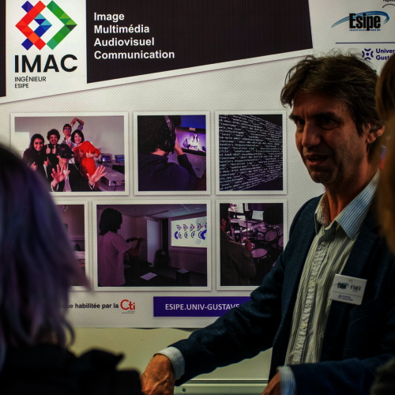  
      On utilise d'une puissance sur chaque canal : exposant 2 pour assombrir, 0.5 pour éclaircir.
    </td>
  </tr>
</table>

---

## 2. Transformations géométriques

On déplace les pixels en jouant avec les coordonnées `x` et `y` et reorganise l'image

<table>
  <tr>
    <td align="center" width="25%">
      <strong>⭐⭐ Miroir</strong>  
      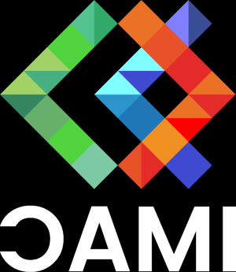  
      Échange des pixels symétriques (<code>x</code> et <code>width - 1 - x</code>). !!que la moitié de l'image (sinon on remet tout comme avant)
    </td>
    <td align="center" width="25%">
      <strong>⭐⭐ Rotation de 90°</strong>  
        
      Création d'une nouvelle image aux dimensions inversées, puis on déplac chaque pixel vers sa nouvelle position.
    </td>
    <td align="center" width="25%">
      <strong>⭐⭐ RGB Split</strong>  
      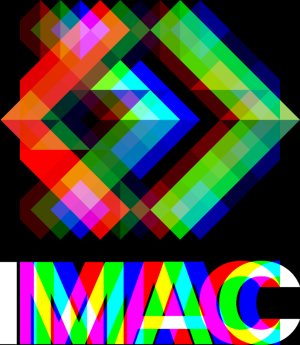  
      Décale le canal rouge vers la droite et le canal bleu vers la gauche. Je crois que y a un petit soucis sur les bords mais j'ai pas fais gaffe avant d'envoyer
    </td>
    <td align="center" width="25%">
      <strong>⭐⭐⭐ Glitch</strong>  
      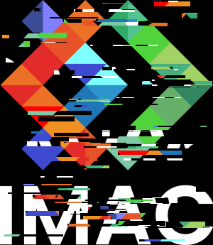  
    Petits rectangles choisis au hasard pour simuler un bug d'affichage
    </td>
  </tr>
</table>

---

## ⭐⭐ 3. Génération d'images à partir de formules

On part d'une image vide et on calcule la couleur de chaque pixel à partir de ses coordonnées `x` et `y`

<table width="100%">
  <tr>
    <td width="33.33%" align="center" valign="top">
      <strong>⭐⭐  Dégradé</strong>  
      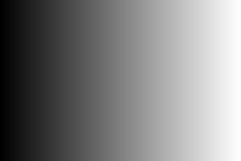  
      On met la valeur de gris proportionnelle à x / (width - 1), du noir au blanc
    </td>
    <td width="33.33%" align="center" valign="top">
      <strong>⭐⭐  Disque</strong>  
        
      Le pixel devient blanc si sa distance au centre est inférieure au rayon
    </td>
    <td width="33.33%" align="center" valign="top">
      <strong>⭐⭐  Cercle</strong>  
      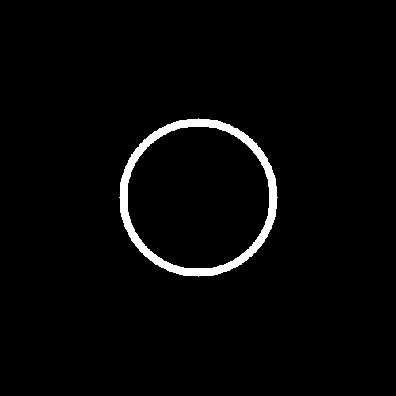  
      Même principe que le disque, mais on conserve uniquement les pixels entre deux rayons
    </td>
  </tr>
</table>

<table width="100%">
  <tr>
    <td align="center" valign="top" width="50%">
      <strong>⭐⭐⭐  Rosace</strong>  
        
      On a plusieurs cercles dont les centres sont placés régulièrement grâce à `cos` et `sin`
    </td>
    <td align="center" valign="top" width="50%">
      <strong>⭐⭐⭐  Fractale de Mandelbrot</strong>  
      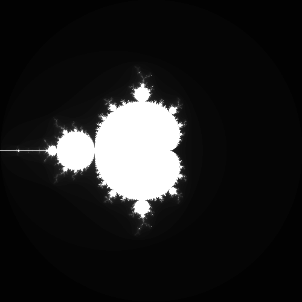  
      Chaque pixel correspond à un nombre complexe `c`. On répète `z = z² + c` et le nombre d'itérations avant que `|z|` dépasse 2 détermine la couleur du pixel
    </td>
  </tr>
</table>

---

## 4. Animations

On génère une série d'images et on les assemble ensuite en GIF

<table>
  <tr>
    <td align="center" width="33%">
      <strong>⭐⭐  Disque en mouvement</strong>  
      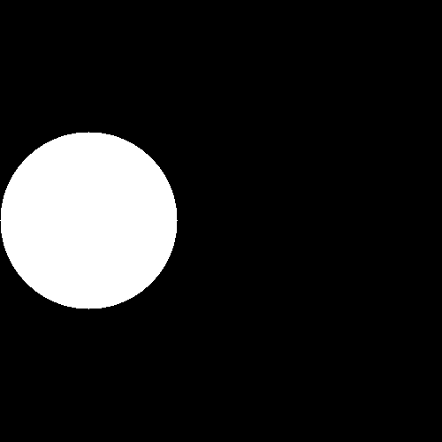  
      Un disque dont le centre avance de 10 pixels à chaque image
    </td>
    <td align="center" width="33%">
      <strong>⭐⭐  Bonus</strong>  
      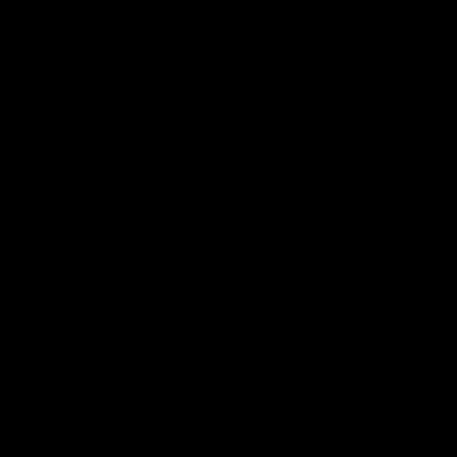  
      Même idée mais avec une photo à la place du disque. J'ai inversé l'ordre des images pour changer le sens du mouvement
    </td>
    <td align="center" width="33%">
      <strong>⭐⭐  Bonus</strong>  
      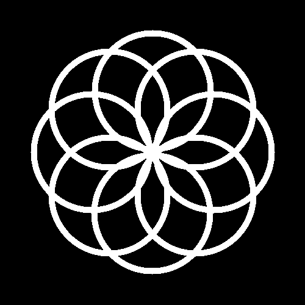  
      Ici la rosace tourne sur elle même : à chaque image j'ajoute un petit angle aux centres des cercles, et avec 40 images ça fait un tour complet 
    </td>
  </tr>
</table>

---

## 5. Mosaïques

On répète un motif avec le modulo `%`

<table width="100%">
  <tr>
    <td align="center" valign="top" width="50%">
      <strong>⭐⭐ Mosaïque</strong>  
      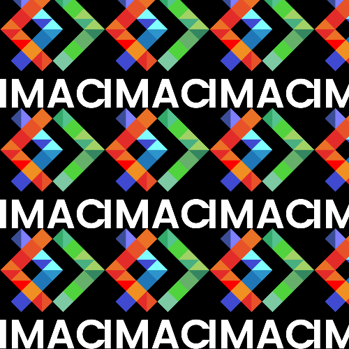  
      On multiplie les coordonnées puis on les ramène dans l'image du motif avec <code>%</code>
    </td>
    <td align="center" valign="top" width="50%">
      <strong>⭐⭐ Mosaïque</strong>  
      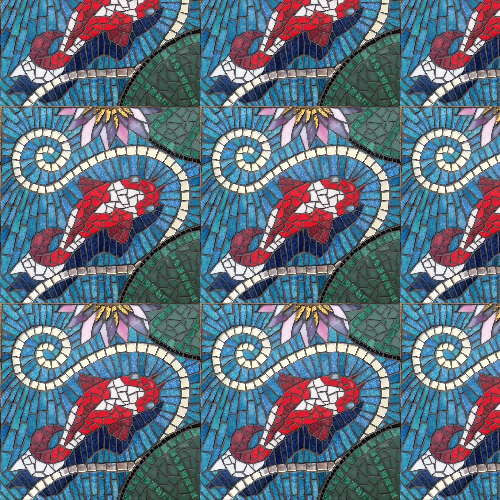  
     
    </td>
  </tr>
</table>

<table>
  <tr>
    <td align="center" width="35%">
      <strong>⭐⭐⭐⭐ Mosaïque miroir</strong>  
      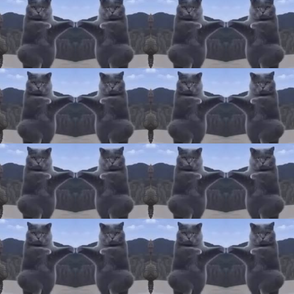
    </td>
    <td valign="top" width="65%">
      
C'est la même chose que la mosaïque normale, sauf qu'une case sur deux est retournée (comme dans un miroir).

      
Pour chaque pixel de l'image finale, on trouve d'abord quel pixel du motif on doit prendre : new_x = (x * taille) % motif.width(), pareil pour y. Le taille sert à réduire le motif pour qu'il se répète plus de fois.

      
Ensuite il faut savoir dans quelle case on est : x * taille / motif.width() (c'est une division entière donc ça donne le numéro de la case, 0, 1, 2...). Si le numéro est impair on retourne le pixel avec new_x = motif.width() - 1 - new_x, et sinon on le laisse comme il est.

      
!! Le numéro de la case se calcule avec x * taille avant le modulo, sinon on a perdu l'info et on sait plus quelle case retourner.

      
!! Ne pas oublier le - 1, sinon sur le dernier pixel on sort du motif.

    </td>
  </tr>
</table>

---

## 6. Tris de pixels

Trois versions avec `std::sort` et le même critère de luminosité, seul ce qu'on trie change

<table>
  <tr>
    <td align="center" width="33%">
      <strong>⭐⭐⭐  Tri par lignes</strong>  
      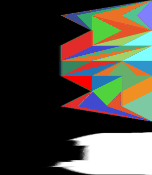  
      Chaque ligne est triée séparément
    </td>
    <td align="center" width="33%">
      <strong>⭐⭐⭐  Tri de tous les pixels</strong>  
      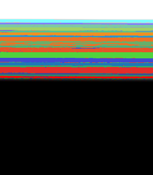  
      Tous les pixels de l'image sont triés d'un coup selon leur luminosité
    </td>
    <td align="center" width="33%">
      <strong>⭐⭐⭐ Tri aléatoire</strong>  
        
      On trie des bouts de lignes de longueur et de position aléatoires. !!bien limiter la fin au bord de l'image
    </td>
  </tr>
</table>

---

## 7. Bruit

<table width="100%">
  <tr>
    <td align="center" width="100%">
      <strong>⭐⭐ Image bruitée</strong>  
      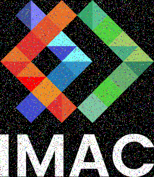  
      Chaque pixel a 10 % de chances d'être remplacé par une couleur aléatoire, ça donne un effet granuleux
    </td>
  </tr>
</table>

---

## 8. Filtres plus avancés

<table width="100%">
  <tr>
    <td align="center" width="50%">
      <strong>⭐⭐⭐⭐⭐ Kuwahara - Rayon 2</strong>  
      
    </td>
    <td align="center" width="50%">
      <strong>⭐⭐⭐⭐⭐ Kuwahara - Rayon 10</strong>  
      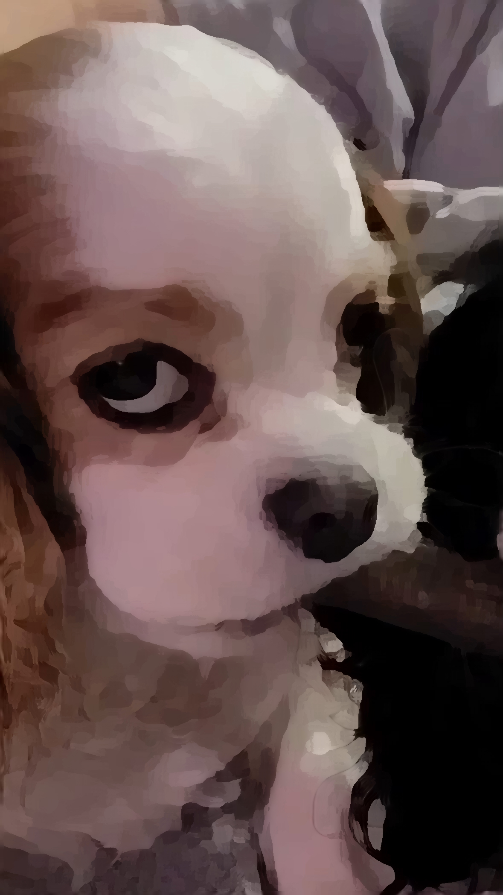
    </td>
  </tr>
</table>

Pour chaque pixel, on regarde 4 carrés autour de lui (haut gauche, haut droite, bas gauche, bas droite).  On calcule la couleur moyenne et la variance pour chaque carré,, ie à quel point les couleurs sont différentes de cette moyenne (avec glm::distance)

On garde ensuite le carré qui a la plus petite variance (donc celui où les couleurs sont les plus proches entre elles). Le pixel prend alors la couleur moyenne de ce carré --> Ca permet de garder les contours sans mélanger les couleurs des deux côtés

Points importants :
- On utilise rayon pour définir la taille des 4 carrés autour du pixel
- On garde la plus petite variance dans une variable min_variance pour savoir quel carré choisir
- Les boucles commencent à rayon et se terminent à width - rayon (pareil pour height) pour ne pas sortir de l'image. Les bords ne sont donc pas modifiés
- Plus le rayon est grand, plus le calcul est long. Avec un rayon de 10 au lieu de 2, on a plus d'effet de peinture, mais on perd les petits détails
